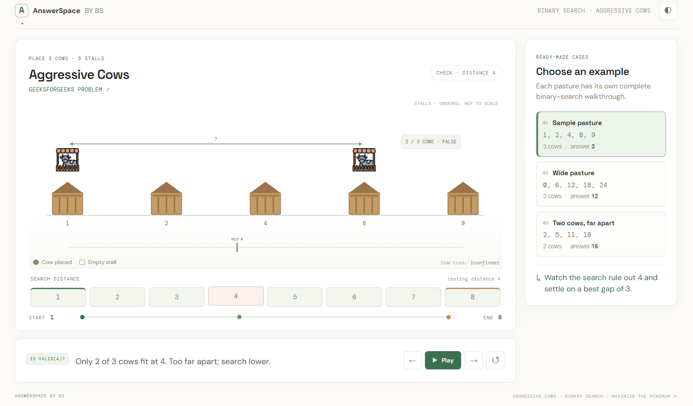

# AnswerSpace — Binary search, told visually

A small visualizer for binary search on answer problems. Open `index.html` for the catalog. Aggressive Cows has three prepared examples; the other listed problems have their own selectable examples and walkthrough routes. Switch between light and dark themes. No build step or dependencies are required.

The Aggressive Cows example uses stall positions `[1, 2, 4, 8, 9]` and 3 cows. Step through the bounds, midpoint checks, and greedy placements to see why the maximum minimum distance is `3`.

## Screenshot

